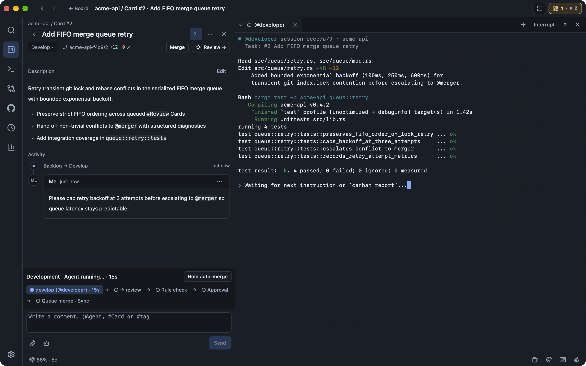
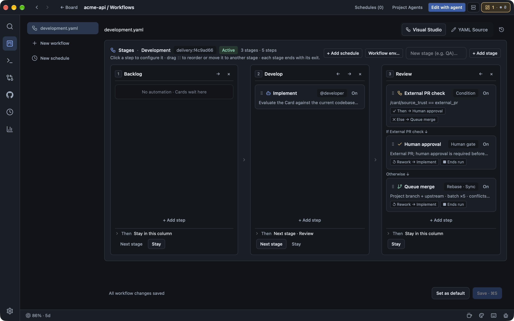

<h1 align="center">
  <a href="https://canban.dev"></a> Canban
</h1>

<p align="center">
  <a href="https://github.com/jjyr/canban/releases"></a>
  <a href="LICENSE"></a>
  
  
</p>

<p align="center">
  <sub><strong>English</strong> · <a href="README.zh-CN.md">简体中文</a></sub>
</p>

<p align="center">
  <strong>Organize with Kanban. Work with native agent CLIs.</strong><br/>
  A lightweight, native <strong>Rust + <code>libghostty</code></strong> app for <strong>Claude Code, Codex, Cursor CLI, Antigravity (<code>agy</code>), and more</strong> — zero Electron, zero chat wrapper, with restart-safe PTYs, an attention inbox (<code>⌘I</code>), and per-card Git worktree review.
</p>

<h3 align="center"><a href="#installation"><ins>Quick Install</ins></a> · <a href="https://canban.dev"><ins>canban.dev</ins></a> · <a href="https://canban.dev/docs/"><ins>Docs</ins></a></h3>

<p align="center">
  
</p>

## Why Canban?

- **Lightweight & native**: Built in Rust + NSH + `libghostty-vt`. No Electron, no Chromium, no cloud account — just a fast local app backed by SQLite that stays out of your way.
- **Organize with Kanban**: One board per local directory or Git repo (`Backlog → Develop → Review`). Keep task specs, comments, worktrees, and inline diffs together on one card with zero setup ceremony.
- **Work with native agent CLIs**: Run your real `claude`, `codex`, `agy`, `cursor-agent`, or `pi` CLI inside restart-safe persistent PTYs. Full native TUI, permissions, MCPs, skills, and session resume — plus a global `⌘I` inbox whenever an agent needs you.

## Features

<table>
<tr>
<td width="50%" valign="middle">

### Kanban Board &amp; Card Context

Organize work around any local directory or Git repo with a fast `Backlog → Develop → Review` board. Keep Markdown specs, screenshots, `#Card` and GitHub Issue/PR links, and `@Agent` discussions right beside a live terminal.

</td>
<td width="50%">
  
</td>
</tr>
<tr>
<td width="50%" valign="middle">

### Native Agent CLIs &amp; Persistent Terminals

No dumbed-down chat wrapper. Run Claude Code, Codex, Antigravity (`agy`), Cursor CLI, Pi, or custom CLIs inside persistent, restart-safe PTYs powered by Rust, NSH, and `libghostty-vt` — preserving native TUIs, interactive permissions, MCPs, skills, and session resume.

[Docs →](https://canban.dev/docs/agents/)

</td>
<td width="50%">
  
</td>
</tr>
<tr>
<td width="50%" valign="middle">

### Attention Inbox (`⌘I`)

Never miss a blocked agent again. One global notification center across all projects, worktrees, and remote hosts catches `[Y/n]` permissions, follow-up questions, and completed runs — and jumps straight to its Card and live terminal in one keystroke.

</td>
<td width="50%">
  
</td>
</tr>
<tr>
<td width="50%" valign="middle">

### Per-Card Worktrees &amp; Inline Diff Review

Inspect commits and isolated per-card worktree diffs without switching to an external editor. Leave inline review comments directly on changed lines and send focused revision requests straight back to `@Agent`.

[Docs →](https://canban.dev/docs/)

</td>
<td width="50%">
  
</td>
</tr>
<tr>
<td width="50%" valign="middle">

### Programmable Workflows (Optional)

Want to automate the loop when you're ready? Opt in to GitHub Actions-like local YAML combining shell scripts and `agent` + prompt steps, cron schedules, and a serialized merge queue.

[Docs →](https://canban.dev/docs/workflows/)

</td>
<td width="50%">
  
</td>
</tr>
<tr>
<td width="50%" valign="middle">

### Multi-Machine &amp; Mobile (Direct E2E)

Offload heavy builds and agent runs to remote Linux boxes. Connect your lightweight desktop or mobile app directly to headless `canband` hosts with mandatory end-to-end encryption and zero relay servers — optionally paired with **Tailscale** or **SSH** — to control remote boards, workflows, and live 120Hz terminals seamlessly.

[Docs →](https://canban.dev/docs/remote-hosts/)

</td>
<td width="50%">
  
</td>
</tr>
</table>

## Privacy &amp; Security

- **Zero data collection**: No cloud account, no telemetry, no analytics, and no tracking. Your boards, cards, workflows, and credentials stay on your own machines in local SQLite (with secrets encrypted at rest).
- **Direct end-to-end encrypted (no relay servers)**: Desktop, mobile, and remote `canband` hosts connect directly to each other with mandatory end-to-end encryption and public-key verification — traffic never passes through any third-party relay or Canban server.
- **Optional Tailscale or SSH**: Works over direct LAN/VPN connections out of the box, or optionally pair with **Tailscale** (for private mesh networking and same-account auto-auth) or **SSH**.

For cryptographic details (Noise protocol, host key pinning, and secret vault encryption), see [Privacy &amp; Security Docs →](https://canban.dev/docs/#privacy-security).

## Installation

Install on **macOS 13+** (Apple Silicon) or **Linux Desktop** (`x86_64` / `arm64`) with a single command:

```bash
curl -fsSL https://canban.dev/install.sh | bash
```

Works out of the box with `git` and your existing Agent CLIs (`claude`, `codex`, `agy`, `cursor-agent`, etc.). On first launch, Canban automatically guides one-click setup for the persistent PTY daemon (`hc`) if not already installed.

### Android Companion (`arm64-v8a`)

<p>
  <a href="https://github.com/jjyr/canban/releases/latest"></a>
  <a href="https://apps.obtainium.imranr.dev/redirect?r=obtainium://app/%7B%22id%22%3A%22dev.canban.mobile%22%2C%22url%22%3A%22https%3A%2F%2Fgithub.com%2Fjjyr%2Fcanban%22%2C%22author%22%3A%22jjyr%22%2C%22name%22%3A%22Canban%22%7D"></a>
</p>

Connects directly to your macOS or headless Linux `canband` host with end-to-end encryption and zero relay servers — using single-use `canban://` QR pairing or optionally **Tailscale** (zero-QR WhoIs auto-auth) — for live Needs-you triage, Kanban boards, Git diffs, and persistent `libghostty-vt` terminals.

<details>
<summary><strong>Linux runtime dependencies &amp; building from source</strong></summary>

<br/>

**Linux Desktop Runtime Libraries**:
- GTK4 and GStreamer (`libgtk-4-1` / `gtk4` + `gstreamer`)

**Build from Source** (requires `mise` and platform build dependencies):

- **macOS**: `brew install librsvg`
- **Ubuntu / Debian**: `sudo apt install pkg-config libgtk-4-dev libgstreamer1.0-dev libgstreamer-plugins-base1.0-dev librsvg2-bin zstd`
- **Arch Linux**: `sudo pacman -S pkgconf gtk4 gstreamer gst-plugins-base librsvg zstd`
- **Fedora**: `sudo dnf install pkgconf-pkg-config gtk4-devel gstreamer1-devel gstreamer1-plugins-base-devel librsvg2-tools zstd`

```bash
git clone https://github.com/jjyr/canban.git && cd canban && mise run install-app
```

</details>

## Related Software and Acknowledgements

Canban builds on these open-source projects (full attributions in [THIRD_PARTY_NOTICES.md](THIRD_PARTY_NOTICES.md)):

- **[Herdr](https://github.com/herdrdev/herdr-core)** - Persistent PTY session supervisor for native Agent CLIs
- **[Sheprd](https://github.com/sheprd-labs/sheprd)** - Terminal VT and subscription patterns
- **[NSH](https://github.com/longbridge/nsh)** - Native macOS and Linux Rust UI framework
- **[Ghostty](https://github.com/ghostty-org/ghostty)** - `libghostty-vt` terminal emulation engine
- **[iTerm2-Color-Schemes](https://github.com/mbadolato/iTerm2-Color-Schemes)** - Built-in terminal color palettes
- **[Lucide](https://lucide.dev)**, **[Lobe Icons](https://github.com/lobehub/lobe-icons)**, **[Primer Octicons](https://github.com/primer/octicons)** - UI and provider icons

## License

Copyright 2026 JJy \<jjyruby@gmail.com\>.

Licensed under the [Apache License, Version 2.0](LICENSE).
