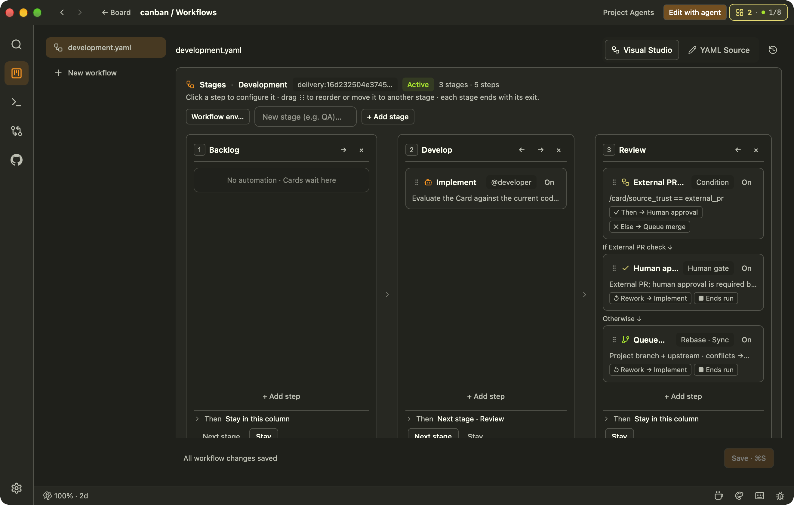

<p align="center">
  
</p>

<h1 align="center">Canban</h1>

<p align="center">
  <strong>Focus on Human Context.</strong><br />
  Organize human intent, reviews, and multi-agent workflows on Kanban — while driving native Agent CLIs directly through Herdr.
</p>

<p align="center">
  <strong>English</strong> · <a href="README.zh-CN.md">简体中文</a>
</p>

<p align="center">
  <a href="#philosophy">Philosophy</a> ·
  <a href="#highlights">Highlights</a> ·
  <a href="#installation-and-upgrading">Installation</a> ·
  <a href="#local-development">Development</a> ·
  <a href="#related-software-and-acknowledgements">Related Software</a> ·
  <a href="#license">License</a>
</p>

<p align="center">
  
</p>

---

## Philosophy

Most AI coding tools trap human context inside ephemeral terminal scrollback or wrap agent CLIs inside brittle custom harnesses. **Canban** takes the opposite approach: **Focus on Human Context**.

1. **Kanban organizes human context.** Specs, Markdown notes, pasted screenshots, `#Card` and `#tag` cross-references, `@Agent` discussions, structured reports (`canban report`), and Git diff/merge gates live together on each Card. Humans stay centered on scope, trade-offs, and review rather than babysitting raw transcripts.
2. **Herdr drives native Agent CLIs with minimal interference.** Instead of re-implementing or sandboxing away the agent harness, Canban launches your native **Claude Code**, **Codex**, **Antigravity (`agy`)**, **Cursor CLI**, or custom agent binaries inside persistent `herdr-core` PTYs — keeping every native TUI, permission prompt, MCP server, skill, hook, and exact session `resume` intact.
3. **Most work stays on Kanban and dispatches via workflows.** Spend your time shaping Cards, answering questions, and reviewing diffs on the Board; let declarative workflows spin up isolated Git worktrees, run `@developer` and `@reviewer` agents, enforce checks, and queue merges back cleanly.

---

## Highlights

### Kanban Built for Human–Agent Collaboration

- **Structured Stages & Live Agent Capsules**: Move Cards across columns (`Backlog → Develop → Review`, or custom stages) with real-time `@developer`, `@reviewer`, and `@merger` status pills and elapsed timers directly on cards.
- **Rich Shared Context**: Markdown editing & preview, clipboard image attachments, `#Card` and `#tag` autocomplete references, `Cmd+O` Quick Open, and structured reports (`canban card adopt` to turn an existing terminal session into a managed Card).
- **GitHub Synchronization & Trust Gates**: Pull GitHub Issues and PRs onto the Board while gating external PRs behind explicit human approval rules.

### GitHub Actions-Style Declarative Workflows

<p align="center">
  
</p>

- **Versioned YAML (`schema: 6`)**: Define pipelines under `.canban/workflows/*.yaml` with triggers (`card.column_entered`, `manual`), column transitions, and composable steps (`uses: agent`, `run` / `script`, `admit`, `card.move`, `condition`, `approval`, `deliver`, `notify`, `complete`).
- **Visual Workflow Studio + YAML Source + Edit with agent**: Switch seamlessly between the stage-by-stage visual editor and raw YAML, or click **Edit with agent** to refactor workflows naturally.
- **Isolated Worktrees & Serialized Queue Merge**: Every Card executes in its own isolated Git worktree (`~/.canban/worktrees/<project>/<card>`) and lands cleanly via FIFO **Queue merge** (`deliver` with conflict handoff to `@merger`).

```yaml
schema: 6
id: development
name: Development
on:
  develop:
    event: card.column_entered
    selector: { column: develop }
    start_at: agent:develop
  review:
    event: card.column_entered
    selector: { column: review }
    start_at: condition:external_pr
steps:
  - id: agent:develop
    name: Implement
    uses: agent
    with: { profile: developer }
    next: move:develop
  - id: move:develop
    uses: card.move
    with: { column: review }
    next: condition:external_pr
  - id: condition:external_pr
    name: External PR check
    uses: condition
    with:
      pointer: /card/source_trust
      equals: external_pr
      then: approval:review
      otherwise: deliver:review
  - id: approval:review
    uses: approval
    on_changes_requested: agent:develop
  - id: deliver:review
    name: Queue merge
    uses: deliver
    with: { sync_upstream: true }
    on_changes_requested: agent:develop
```

### Native Herdr Terminal — Switch Between Kanban & Terminal Anytime

<p align="center">
  
</p>

- **Kanban ↔ Terminal Without Losing Flow**: Press `Cmd+J` inside any Card to toggle a side-by-side PTY split alongside the Markdown spec and timeline, or jump to the dedicated **Terminals** workspace with tabs scoped to each Card worktree.
- **Native Performance & Multi-Session Durability**: Built in Rust on top of `longbridge/nsh` (native macOS AppKit/Metal UI) and `libghostty-vt`. Background `AppServer` and `herdr-core` daemons decouple agent and shell processes from the UI window — restart, quit, or upgrade Canban without killing running agent PTYs.
- **Local or Remote SSH Core + 17 Built-in Dark Themes**: Dispatch workflows and terminals on local macOS or remote SSH Core machines, rendered with Canban Default plus 16 classic dark themes (Monokai shown above).

---

## Installation and Upgrading

### Prerequisites

- **OS & Architecture**: macOS 13.0+ (Apple Silicon / `arm64`)
- **Required Tools**: `git`, at least one native Agent CLI (for example `claude`, `codex`, `agy`, or `cursor-agent`), and **Herdr Core (`hc`)**
  - On first launch, Canban checks for `hc` and offers a guided one-click install if it is missing; you can also install Herdr Core beforehand:
  ```bash
  curl -fsSL https://releases.herdr.dev/core/install.sh | sh
  ```

### One-Line Install & Live Upgrade

Run the following command in Terminal to install Canban to `/Applications/Canban.app`, or safely upgrade an existing installation:

```bash
curl -fsSL https://raw.githubusercontent.com/jjyr/canban/main/scripts/install.sh | bash
```

What [`scripts/install.sh`](scripts/install.sh) handles automatically:

- **Release Verification**: Downloads `manifest-macos-aarch64.json` and the matching `.tar.gz` (or `.tar.zst`) bundle from GitHub Releases, verifying exact byte size, SHA-256 checksum, and `canban build-info` commit/schema metadata before touching `/Applications`.
- **macOS Gatekeeper & Signature Handling**: Strips `com.apple.quarantine` extended attributes (`xattr -dr com.apple.quarantine`) and applies a strict local deep ad-hoc signature (`codesign --force --deep --sign - --timestamp=none`) on the extracted bundle so macOS opens it cleanly even for unsigned community builds.
- **Safe Live Upgrades**:
  - Gracefully stops running `canban-ui` and `canban` (`AppServer`) **without stopping `herdr-core`**, so active agent and shell PTYs stay alive throughout the upgrade.
  - Backs up `~/.canban/canban.sqlite` (`-wal` / `-shm` included) under `~/.canban/updates/` and runs SQLite schema migrations before atomically swapping `/Applications/Canban.app`.
  - Refuses downgrades when an existing database schema is newer than the target release.
  - Reopens Canban automatically once the swap finishes (pass `--no-restart` to opt out).

**Installer Options**

```bash
# Install or pin a specific release tag (e.g. 20261114-1)
curl -fsSL https://raw.githubusercontent.com/jjyr/canban/main/scripts/install.sh | bash -s -- --version <YYYYMMDD-N>

# Force reinstall the same version without restarting
curl -fsSL https://raw.githubusercontent.com/jjyr/canban/main/scripts/install.sh | bash -s -- --force --no-restart
```

See `--help` for `--dest <path>` and `--home <path>`. Once installed, Canban also checks GitHub Releases in-app and lets you apply upgrades from the sidebar banner in one click (see [In-App Updates](docs/updates.md)).

<details>
<summary>Manual Archive Installation (<code>.tar.gz</code>)</summary>

1. Download `Canban-macos-aarch64.tar.gz` and `manifest-macos-aarch64.json` from [GitHub Releases](https://github.com/jjyr/canban/releases/latest), verify the `shasum -a 256` digest matches the manifest, and extract `Canban.app` into `/Applications/`.
2. Remove the macOS quarantine attribute and refresh the local ad-hoc signature before launching:

```bash
xattr -dr com.apple.quarantine /Applications/Canban.app
codesign --force --deep --sign - --timestamp=none /Applications/Canban.app
open /Applications/Canban.app
```

</details>

---

## Local Development

Prerequisites: macOS, Xcode Command Line Tools, [`mise`](https://mise.jdx.dev/) (pinned Rust toolchain & Zig for `libghostty-vt`), `librsvg` (`brew install librsvg` for icon generation), and a compatible `hc` binary.

```bash
# Start an isolated branch-scoped Dev App + AppServer (does not touch ~/.canban)
mise run dev
mise run dev-stop

# Run tests, standalone UI component gallery, and isolated acceptance suites
mise run test
mise run gallery
mise run test-install
mise run acceptance
mise run acceptance-interactive

# Build release bundle and install atomically to /Applications/Canban.app
mise run install-app
```

Further documentation:

- [Documentation Index](docs/README.md) — architecture, workflows, UI kit, and design notes
- [Implementation & Acceptance](docs/implementation.md) — implemented MVP scope vs. proposals
- [Development Conventions](docs/development-conventions.md) — crate structure, schema migrations, and workflow guidelines
- [Development Instances](docs/development-startup.md) · [Multi-Machine Core](docs/multi-machine.md) · [UI Component Gallery](examples/README.md)

### Feedback

Use **Report issue** inside Canban to pre-fill environment details, or open a [Bug Report](https://github.com/jjyr/canban/issues/new?template=bug_report.yml) / [Feature Request](https://github.com/jjyr/canban/issues/new?template=feature_request.yml) on GitHub.

---

## Related Software and Acknowledgements

Canban builds directly on these open-source projects and assets (full attributions and licenses are preserved in [THIRD_PARTY_NOTICES.md](THIRD_PARTY_NOTICES.md)):

- **[Herdr (`herdr-core`)](https://github.com/herdrdev/herdr-core)** — Persistent PTY session supervisor and JSON-RPC runtime powering native Agent CLIs and interactive terminals (Apache-2.0)
- **[Sheprd](https://github.com/sheprd-labs/sheprd)** — Terminal VT/frame/input and subscription utility patterns referenced during integration (Apache-2.0)
- **[NSH (`longbridge/nsh`)](https://github.com/longbridge/nsh)** — Native macOS AppKit/Metal Rust UI framework (Apache-2.0)
- **[Ghostty (`libghostty-vt`)](https://github.com/ghostty-org/ghostty)** — Commit-pinned VT parser and terminal emulation engine (MIT)
- **Native Agent CLIs** — Compatible with [Claude Code](https://docs.anthropic.com/en/docs/claude-code), [OpenAI Codex CLI](https://github.com/openai/codex), Antigravity (`agy`), Cursor CLI, and custom CLI profiles
- **[iTerm2-Color-Schemes](https://github.com/mbadolato/iTerm2-Color-Schemes)** (MIT) — 16 classic terminal color palettes including Monokai, Dracula, Nord, Tokyo Night, and Catppuccin Mocha
- **[Lucide](https://lucide.dev)** (ISC), **[Lobe Icons](https://github.com/lobehub/lobe-icons)** (MIT), and **[Primer Octicons](https://github.com/primer/octicons)** (MIT) — UI and provider icons

---

## License

Copyright 2026 JJy \<jjyruby@gmail.com\>.

Licensed under the [Apache License, Version 2.0](LICENSE).
