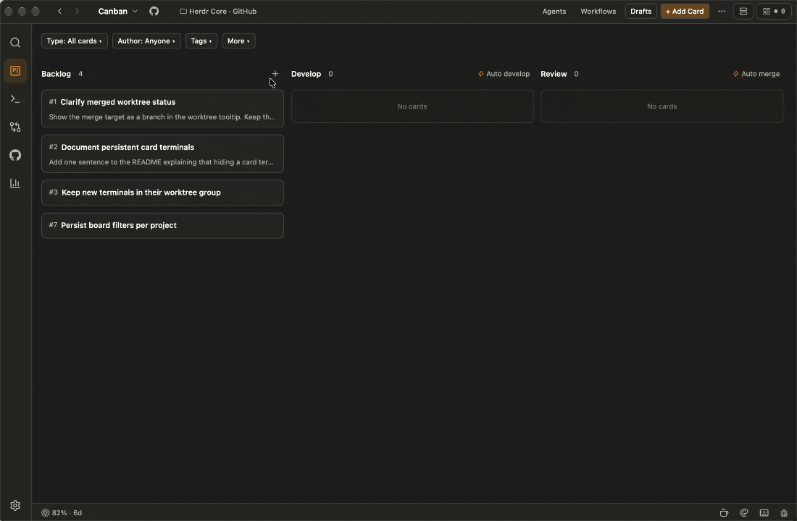

<p align="center">
  
</p>

# Canban

**Turn Kanban cards into automated coding workflows, without replacing your native agent CLIs.**

<p align="center">
  <a href="https://github.com/jjyr/canban/releases"></a>
  <a href="LICENSE"></a>
  
  
</p>

<p align="center">
  
</p>

<p align="center">
  <strong>English</strong> · <a href="README.zh-CN.md">简体中文</a>
</p>

<p align="center">
  <a href="https://canban.dev"><strong>Website (canban.dev)</strong></a> ·
  <a href="#philosophy">Philosophy</a> ·
  <a href="#highlights">Highlights</a> ·
  <a href="#installation">Installation</a> ·
  <a href="docs/README.md">Docs</a> ·
  <a href="#related-software-and-acknowledgements">Related Software</a> ·
  <a href="#license">License</a>
</p>

---

## Philosophy

1. **Kanban organizes human context** — specs, `#Card` references, screenshots, `@Agent` discussions, structured reports, and review gates stay together on each Card.
2. **Herdr drives native Agent CLIs with minimal interference** — run Claude Code, Codex, Antigravity (`agy`), Cursor CLI, or custom CLIs directly inside persistent PTYs with native TUIs, permissions, MCPs, skills, and session resume intact.
3. **Most work stays on Kanban and dispatches via workflows** — shape scope and review diffs on the Board while workflows isolate Git worktrees, dispatch agents, and queue merges automatically.

---

## Highlights

- **Kanban for human context** — Keep feature specs, screenshots, agent discussions, and review decisions together on each card, with live agent progress visible on the board.

- **Automated coding workflows** — Drag a card into `Develop` to dispatch coding agents automatically. Build GitHub Actions-like workflows with custom scripts, conditions, and human approval steps.

- **Isolated Git worktrees & merge queue** — Run tasks independently in per-card Git worktrees, then deliver changes through a serialized local merge queue with agent-assisted conflict resolution.

- **Native agent CLIs** — Run Claude Code, Codex, Antigravity, Cursor CLI, and custom agents through Herdr, preserving their native TUIs, permissions, MCPs, and skills.

- **Restart-safe execution** — Keep coding agents running even when Canban restarts or upgrades, without interrupting ongoing work.

- **Remote machine support** — Connect to remote Linux machines via SSH/Tailscale and run coding agents remotely.

- **GitHub integration** — Turn GitHub Issues and PRs into Kanban cards and run workflows on them just like local cards.

---

## Installation

**Prerequisites**:
- **macOS**: macOS 13.0+ (Apple Silicon / `arm64`)
- **Linux Desktop**: `x86_64` or `aarch64` (`arm64`) with GTK4 and GStreamer runtime libraries (`libgtk-4-1` / `gtk4` + `gstreamer`)
- **Common**: `git`, at least one native Agent CLI (`claude`, `codex`, `agy`, `cursor-agent`, etc.), and **Herdr Core (`hc`)** (Canban guides one-click `hc` setup on first launch if missing).

```bash
curl -fsSL https://canban.dev/install.sh | bash
```

- **macOS**: Installs or live-upgrades `/Applications/Canban.app`, automatically handling Gatekeeper quarantine removal and local ad-hoc code signing.
- **Linux Desktop**: Installs or live-upgrades `~/.local/opt/canban`, links `~/.local/bin/{canban,canban-ui}`, and registers the XDG `.desktop` launcher and icons (`~/.local/share/applications` & `icons/hicolor`).
- **Headless Linux Host (`canband`)**: On remote Linux servers without a desktop session, pass `--headless` (`curl -fsSL https://canban.dev/install.sh | bash -s -- --headless`) to install standalone `~/.local/bin/canban` without GTK4 dependencies. Active `herdr-core` sessions and `systemd --user` `canban.service` units are preserved across upgrades.

### Build from Source

Install `mise` plus platform build dependencies, then run `mise run install-app`:

- **macOS**: `brew install librsvg`
- **Ubuntu / Debian**: `sudo apt install pkg-config libgtk-4-dev libgstreamer1.0-dev libgstreamer-plugins-base1.0-dev librsvg2-bin zstd`
- **Arch Linux**: `sudo pacman -S pkgconf gtk4 gstreamer gst-plugins-base librsvg zstd`
- **Fedora**: `sudo dnf install pkgconf-pkg-config gtk4-devel gstreamer1-devel gstreamer1-plugins-base-devel librsvg2-tools zstd`

```bash
git clone https://github.com/jjyr/canban.git && cd canban && mise run install-app
```

---

## Related Software and Acknowledgements

Canban builds directly on these open-source projects and assets (full attributions and licenses are preserved in [THIRD_PARTY_NOTICES.md](THIRD_PARTY_NOTICES.md)):

- **[Herdr (`herdr-core`)](https://github.com/herdrdev/herdr-core)** — Persistent PTY session supervisor and JSON-RPC runtime powering native Agent CLIs and interactive terminals (Apache-2.0)
- **[Sheprd](https://github.com/sheprd-labs/sheprd)** — Terminal VT/frame/input and subscription utility patterns referenced during integration (Apache-2.0)
- **[NSH (`longbridge/nsh`)](https://github.com/longbridge/nsh)** — Native macOS (AppKit/Metal) and Linux (GTK4) Rust UI framework (Apache-2.0)
- **[Ghostty (`libghostty-vt`)](https://github.com/ghostty-org/ghostty)** — Commit-pinned VT parser and terminal emulation engine (MIT)
- **[iTerm2-Color-Schemes](https://github.com/mbadolato/iTerm2-Color-Schemes)** (MIT) — 16 classic terminal color palettes including Monokai, Dracula, Nord, Tokyo Night, and Catppuccin Mocha
- **[Lucide](https://lucide.dev)** (ISC), **[Lobe Icons](https://github.com/lobehub/lobe-icons)** (MIT), and **[Primer Octicons](https://github.com/primer/octicons)** (MIT) — UI and provider icons

---

## License

Copyright 2026 JJy \<jjyruby@gmail.com\>.

Licensed under the [Apache License, Version 2.0](LICENSE).
