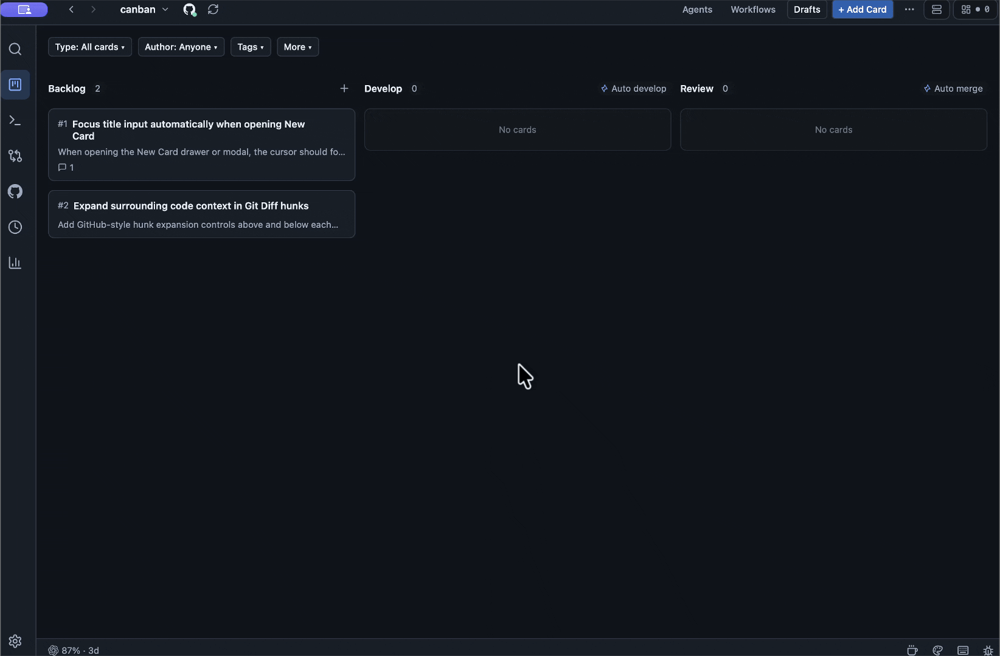
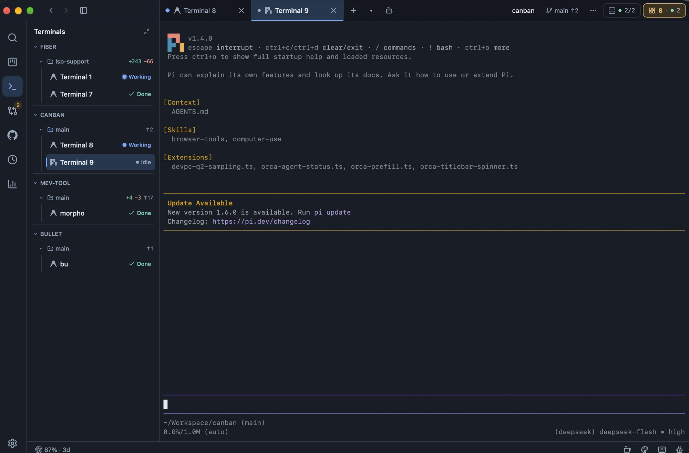
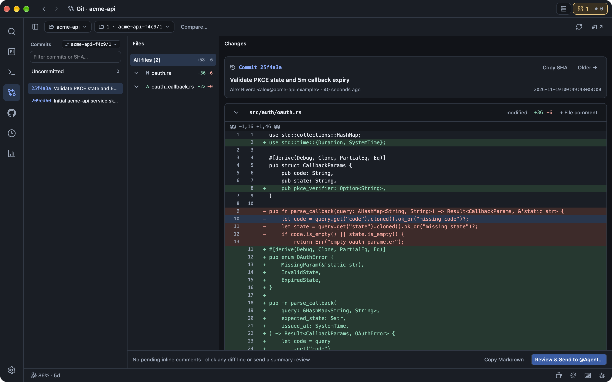

<h1 align="center">
  <a href="https://canban.dev"></a> Canban
</h1>

<p align="center">
  <a href="https://github.com/jjyr/canban/releases"></a>
  <a href="LICENSE"></a>
  
  
</p>

<p align="center">
  <sub><strong>English</strong> · <a href="README.zh-CN.md">简体中文</a></sub>
</p>

<p align="center">
  <strong>Keep your agent CLI. Automate your workflow.</strong><br/>
  Organize context on flexible cards, catch waiting agents in one notification center, and automate tasks with GitHub Actions-like workflows.
</p>

<h3 align="center"><a href="#installation"><ins>Install Canban</ins></a> · <a href="https://canban.dev"><ins>canban.dev</ins></a></h3>

<p align="center">
  
</p>

## Features

<table>
<tr>
<td width="50%" valign="middle">

### Programmable Workflows (Vibe Mode)

Write GitHub Actions-like YAML with shell scripts and `agent` + prompt steps. Turn any card into a `plan → develop → merge` pipeline with isolated Git worktrees, cron schedules, and a serialized merge queue.

[Docs →](https://canban.dev/docs/workflows/)

</td>
<td width="50%">
  
</td>
</tr>
<tr>
<td width="50%" valign="middle">

### Native Agent CLI &amp; Terminals

No chat UI. Run Claude Code, Codex, Antigravity (`agy`), Cursor CLI, Pi, or custom CLIs directly inside persistent, restart-safe PTYs powered by Rust, NSH, and `libghostty-vt`, keeping native TUIs, permissions, MCPs, skills, and session resume intact.

[Docs →](https://canban.dev/docs/agents/)

</td>
<td width="50%">
  
</td>
</tr>
<tr>
<td width="50%" valign="middle">

### Multi-Machine

Connect your local desktop app to headless Linux `canband` hosts over SSH or Tailscale. Manage remote boards, workflows, and live terminals seamlessly alongside local projects.

[Docs →](https://canban.dev/docs/remote-hosts/)

</td>
<td width="50%">
  
</td>
</tr>
<tr>
<td width="50%" valign="middle">

### Built-in Git &amp; Diff Review

Inspect commits and per-card worktree diffs without leaving Canban. Leave inline review comments on changed lines and send focused feedback straight to `@Agent`.

[Docs →](https://canban.dev/docs/)

</td>
<td width="50%">
  
</td>
</tr>
<tr>
<td width="50%" valign="middle">

### Notification Center

One attention inbox across all projects, worktrees, and hosts (`⌘I`). Instantly see which agent is waiting for input, approval, or review, and jump straight to its Card and live terminal.

</td>
<td width="50%">
  
</td>
</tr>
</table>

## Installation

**Prerequisites**:
- **macOS**: macOS 13.0+ (Apple Silicon / `arm64`)
- **Linux Desktop**: `x86_64` or `aarch64` (`arm64`) with GTK4 and GStreamer runtime libraries (`libgtk-4-1` / `gtk4` + `gstreamer`)
- **Common**: `git`, at least one native Agent CLI (`claude`, `codex`, `agy`, `cursor-agent`, etc.), and **Herdr Core (`hc`)** (Canban guides one-click `hc` setup on first launch if missing).

```bash
curl -fsSL https://canban.dev/install.sh | bash
```

### Build from Source

Install `mise` plus platform build dependencies, then run `mise run install-app`:

- **macOS**: `brew install librsvg`
- **Ubuntu / Debian**: `sudo apt install pkg-config libgtk-4-dev libgstreamer1.0-dev libgstreamer-plugins-base1.0-dev librsvg2-bin zstd`
- **Arch Linux**: `sudo pacman -S pkgconf gtk4 gstreamer gst-plugins-base librsvg zstd`
- **Fedora**: `sudo dnf install pkgconf-pkg-config gtk4-devel gstreamer1-devel gstreamer1-plugins-base-devel librsvg2-tools zstd`

```bash
git clone https://github.com/jjyr/canban.git && cd canban && mise run install-app
```

## Related Software and Acknowledgements

Canban builds on these open-source projects (full attributions in [THIRD_PARTY_NOTICES.md](THIRD_PARTY_NOTICES.md)):

- **[Herdr](https://github.com/herdrdev/herdr-core)** - Persistent PTY session supervisor for native Agent CLIs
- **[Sheprd](https://github.com/sheprd-labs/sheprd)** - Terminal VT and subscription patterns
- **[NSH](https://github.com/longbridge/nsh)** - Native macOS and Linux Rust UI framework
- **[Ghostty](https://github.com/ghostty-org/ghostty)** - `libghostty-vt` terminal emulation engine
- **[iTerm2-Color-Schemes](https://github.com/mbadolato/iTerm2-Color-Schemes)** - Built-in terminal color palettes
- **[Lucide](https://lucide.dev)**, **[Lobe Icons](https://github.com/lobehub/lobe-icons)**, **[Primer Octicons](https://github.com/primer/octicons)** - UI and provider icons

## License

Copyright 2026 JJy \<jjyruby@gmail.com\>.

Licensed under the [Apache License, Version 2.0](LICENSE).
