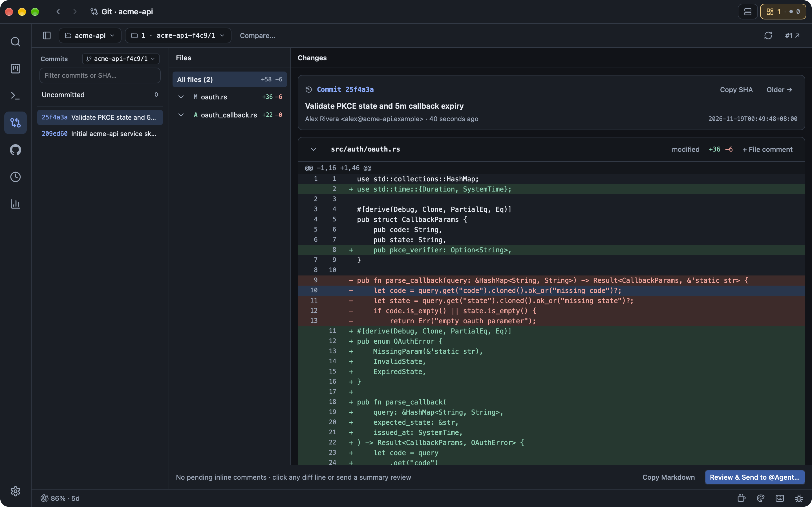

<h1 align="center">
  <a href="https://canban.dev/zh/"></a> Canban
</h1>

<p align="center">
  <a href="https://github.com/jjyr/canban/releases"></a>
  <a href="LICENSE"></a>
  
  
</p>

<p align="center">
  <sub><a href="README.md">English</a> · <strong>简体中文</strong></sub>
</p>

<p align="center">
  <strong>同时并行 10+ 个 Coding Agent，告别在十几个终端标签页里迷失。</strong><br/>
  基于原生 <strong>Rust + <code>libghostty</code></strong> 构建的 <strong>Claude Code、Codex、Cursor CLI</strong> 工作台 —— 内置全局注意力收件箱（<code>⌘I</code>）、单卡片隔离 Git Worktree 行级代码审查，以及类 GitHub Actions 的本地自动化流水线。
</p>

<h3 align="center"><a href="#安装"><ins>快速安装</ins></a> · <a href="https://canban.dev/zh/"><ins>canban.dev</ins></a> · <a href="https://canban.dev/zh/docs/"><ins>文档</ins></a></h3>

<p align="center">
  
</p>

## 为什么选择 Canban？

- **不再盲目翻找 10 个 tmux 窗口**：全局注意力收件箱（`⌘I`）跨所有项目与远程主机，第一时间捕获哪个 Agent 正在等待 `[Y/n]` 权限确认、追问输入或代码审查，一键直达现场。
- **零阉割的原生终端体验**：不做简陋的聊天框套壳。基于原生 Rust UI 与 `libghostty-vt` 驱动持久化防中断 PTY，直接运行你的 `claude`、`codex`、`agy` 或 `cursor-agent`，即使关闭或重启应用，终端会话依然存活。
- **不切编辑器完成 Diff 审查与合并**：每张卡片自动分配独立 Git Worktree，内置行级 Diff 审查（直接在代码变更行写评论并 `@Agent` 返工），配合串行合并队列实现 `plan → develop → merge` 闭环。

## 核心功能

<table>
<tr>
<td width="50%" valign="middle">

### 全局注意力收件箱（`⌘I`）

不再漏掉任何一个卡住等待的 Agent。跨项目、跨 Worktree 与跨主机的全局通知中心，一眼看清哪个 Agent 正在等待输入、工具权限审批或代码审查，一次按键直达对应卡片与实时终端。

</td>
<td width="50%">
  
</td>
</tr>
<tr>
<td width="50%" valign="middle">

### 原生 Agent CLI 与持久化终端

拒绝聊天框套壳。在基于 Rust、NSH 与 `libghostty-vt` 构建的持久化防中断 PTY 中，直接运行 Claude Code、Codex、Antigravity（`agy`）、Cursor CLI、Pi 或自定义 CLI，完整保留原生 TUI、权限交互、MCP、Skills 与会话恢复能力。

[文档 →](https://canban.dev/zh/docs/agents/)

</td>
<td width="50%">
  
</td>
</tr>
<tr>
<td width="50%" valign="middle">

### 独立 Worktree 与行内 Diff 审查

无需切出应用去开外部编辑器，直接查看提交历史与单卡片隔离 Worktree 的代码改动。支持在变更代码行上直接添加行内评审意见，并一键发送给 `@Agent` 继续修改。

[文档 →](https://canban.dev/zh/docs/)

</td>
<td width="50%">
  
</td>
</tr>
<tr>
<td width="50%" valign="middle">

### 可编程工作流（本地 Agent 的 GitHub Actions）

用类似 GitHub Actions 的 YAML 编排 Shell 脚本与 `agent` + prompt 步骤。将任意卡片转化为无人值守的 `plan → develop → merge` 自动化流水线，内置定时触发（Cron）与串行合并队列。

[文档 →](https://canban.dev/zh/docs/workflows/)

</td>
<td width="50%">
  
</td>
</tr>
<tr>
<td width="50%" valign="middle">

### SSH / Tailscale 多机器协同

把高负载编译和 Agent 任务交给远程 Linux 主机。通过 SSH 或 Tailscale 将本地桌面端连接到无头 `canband` 主机，像操作本地项目一样丝滑管理远程看板、工作流与 120Hz 实时终端。

[文档 →](https://canban.dev/zh/docs/remote-hosts/)

</td>
<td width="50%">
  
</td>
</tr>
</table>

## 安装

在 **macOS 13+**（Apple Silicon）或 **Linux 桌面版**（`x86_64` / `arm64`）上一键安装：

```bash
curl -fsSL https://canban.dev/install.sh | bash
```

开箱即用，直接复用你现有的 `git` 与各类 Agent CLI（`claude`、`codex`、`agy`、`cursor-agent` 等）。首次启动时，若未安装持久化终端守护进程（`hc`），Canban 会自动引导一键完成配置。

<details>
<summary><strong>Linux 运行库要求与从源码构建</strong></summary>

<br/>

**Linux 桌面版运行库依赖**：
- 已安装 GTK4 与 GStreamer 运行库（`libgtk-4-1` / `gtk4` + `gstreamer`）

**从源码构建**（需安装 `mise` 与系统构建依赖后执行 `mise run install-app`）：

- **macOS**：`brew install librsvg`
- **Ubuntu / Debian**：`sudo apt install pkg-config libgtk-4-dev libgstreamer1.0-dev libgstreamer-plugins-base1.0-dev librsvg2-bin zstd`
- **Arch Linux**：`sudo pacman -S pkgconf gtk4 gstreamer gst-plugins-base librsvg zstd`
- **Fedora**：`sudo dnf install pkgconf-pkg-config gtk4-devel gstreamer1-devel gstreamer1-plugins-base-devel librsvg2-tools zstd`

```bash
git clone https://github.com/jjyr/canban.git && cd canban && mise run install-app
```

</details>

## 相关软件与致谢

Canban 基于以下开源项目构建（完整归属与许可证见 [THIRD_PARTY_NOTICES.md](THIRD_PARTY_NOTICES.md)）：

- **[Herdr](https://github.com/herdrdev/herdr-core)** - 面向原生 Agent CLI 的持久化 PTY 会话监督引擎
- **[Sheprd](https://github.com/sheprd-labs/sheprd)** - 终端 VT 与订阅交互实践参考
- **[NSH](https://github.com/longbridge/nsh)** - 原生 macOS 与 Linux Rust UI 框架
- **[Ghostty](https://github.com/ghostty-org/ghostty)** - `libghostty-vt` 终端解析与渲染内核
- **[iTerm2-Color-Schemes](https://github.com/mbadolato/iTerm2-Color-Schemes)** - 内置终端配色方案
- **[Lucide](https://lucide.dev)**、**[Lobe Icons](https://github.com/lobehub/lobe-icons)**、**[Primer Octicons](https://github.com/primer/octicons)** - UI 与模型/服务商图标

## 开源协议

Copyright 2026 JJy \<jjyruby@gmail.com\>.

本项目基于 [Apache License, Version 2.0](LICENSE) 开源。
