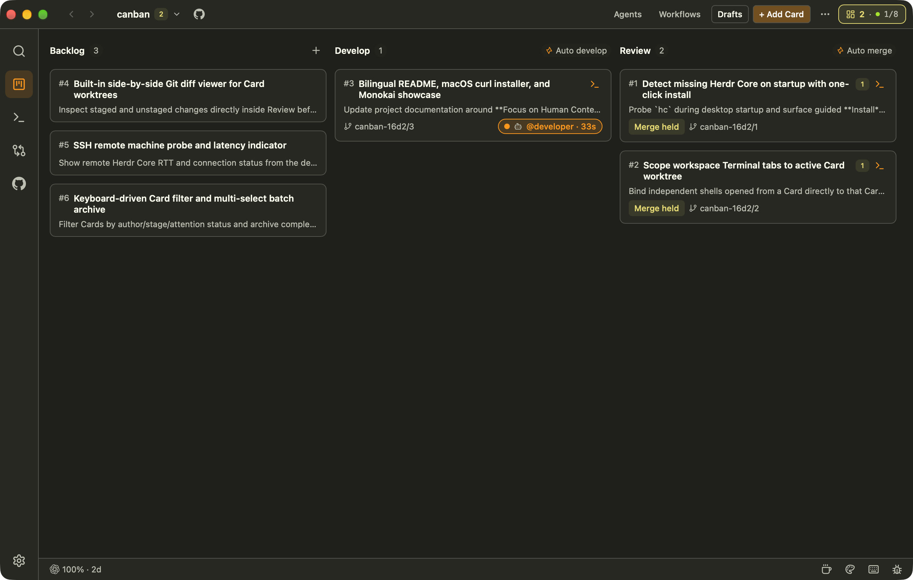
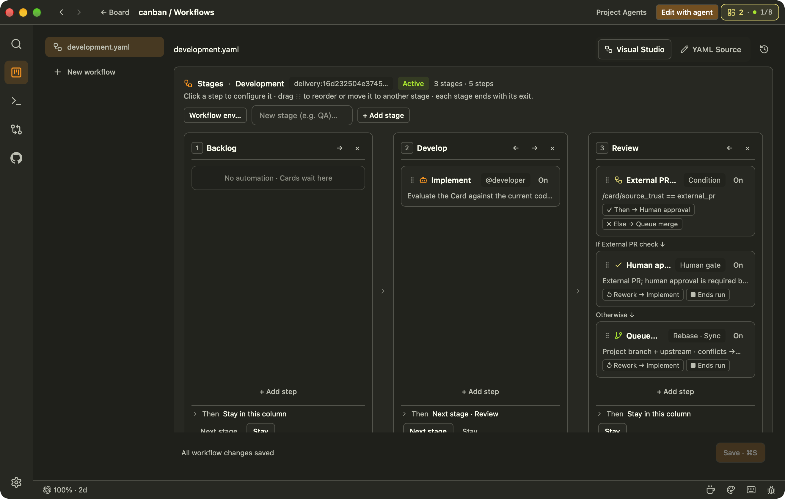
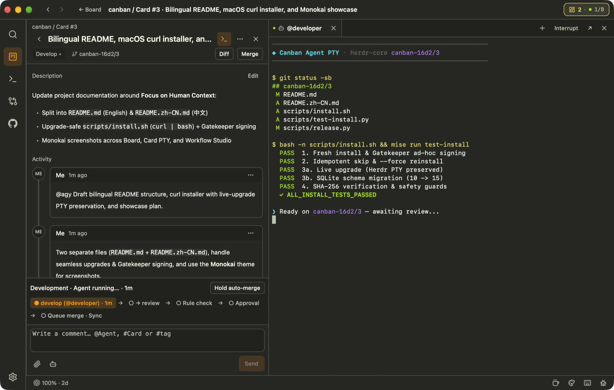

<p align="center">
  
</p>

<h1 align="center">Canban</h1>

<p align="center">
  <strong>Focus on Human Context.</strong><br />
  用 Kanban 组织人类上下文，借助 Declarative Workflow 编排多 Agent 协作，并通过 Herdr 无干预驱动原生 Agent CLI。
</p>

<p align="center">
  <a href="README.md">English</a> · <strong>简体中文</strong>
</p>

<p align="center">
  <a href="#设计哲学">设计哲学</a> ·
  <a href="#核心亮点">核心亮点</a> ·
  <a href="#安装与升级">安装与升级</a> ·
  <a href="#本地开发">本地开发</a> ·
  <a href="#相关软件与致谢">相关软件与致谢</a> ·
  <a href="#开源协议">开源协议</a>
</p>

<p align="center">
  
</p>

---

## 设计哲学

大多数 AI 编程工具要么把人类的决策上下文淹没在转瞬即逝的终端滚动历史里，要么用笨重的自定义壳（harness）接管工具链、破坏原本的 Agent CLI 体验。**Canban** 的核心设计哲学是：**Focus on Human Context（聚焦人类上下文）**。

1. **用 Kanban 组织人类上下文。** 需求说明（Markdown）、粘贴的截图、`#Card` 与 `#tag` 关联、`@Agent` 讨论串、结构化报告（`canban report`），以及 Git Diff / 人工审批 / 合并门禁全部沉淀在每一张 Card 上，让人始终聚焦意图、边界与审查，而不是在海量日志里翻找上下文。
2. **通过 Herdr 调用原生 Agent CLI，尽量减少干涉。** Canban 不改写或包裹 Agent 本身，而是利用 `herdr-core` 在持久化 PTY 中直接运行你本机的 **Claude Code**、**Codex**、**Antigravity (`agy`)**、**Cursor CLI** 或自定义 CLI——完整保留原生 TUI、权限确认交互、MCP Server、Skills、Hooks 与精确 Session `resume`。
3. **日常工作主要在 Kanban 完成，并通过 Workflow 派发给 Agent。** 你在看板上整理需求、回答阻塞问题、审查变更，剩下的工作交由声明式工作流自动拉起独立 Git Worktree、调度 `@developer` / `@reviewer` / `@merger`、执行检查并串行合入主分支。

---

## 核心亮点

### 面向人机协作的 Kanban 看板

- **多阶段流转与实时运行态胶囊**：Card 沿 `Backlog → Develop → Review`（或自定义列）推进，看板卡片直接呈现 `@developer`、`@reviewer`、`@merger` 的实时运行状态、所用 CLI 与耗时。
- **完整的人类上下文底座**：原生 Markdown 编辑与预览、剪贴板粘贴图片附件、`#Card` / `#tag` 智能引用补全、`Cmd+O` 快速跳转，以及 `canban card adopt` 将现有终端会话收编为托管 Card。
- **GitHub 同步与外部 PR 信任门禁**：同步 GitHub Issues 与 PR 到看板，并在外部 PR 合入前自动触发人工审批规则。

### 类 GitHub Actions 的声明式 Workflow

<p align="center">
  
</p>

- **仓库级 YAML 编排（`schema: 6`）**：在 `.canban/workflows/*.yaml` 中定义触发器（`card.column_entered`、`manual`）、列流转与可组合步骤（`uses: agent`、`run` / `script`、`admit`、`card.move`、`condition`、`approval`、`deliver`、`notify`、`complete`）。
- **可视化 Workflow Studio + YAML 源码 + Edit with agent**：可在阶段编排视图与 YAML 源码之间即时切换，或点击 **Edit with agent** 让 Agent 协助修改工作流。
- **独立 Worktree 与串行队列合并（Queue merge）**：每张 Card 在独立的 Git worktree（`~/.canban/worktrees/<project>/<card>`）中隔离开发；进入交付阶段后通过 FIFO 合并队列（`deliver`）自动同步上游并在冲突时调度 `@merger` 处理。

```yaml
schema: 6
id: development
name: Development
on:
  develop:
    event: card.column_entered
    selector: { column: develop }
    start_at: agent:develop
  review:
    event: card.column_entered
    selector: { column: review }
    start_at: condition:external_pr
steps:
  - id: agent:develop
    name: Implement
    uses: agent
    with: { profile: developer }
    next: move:develop
  - id: move:develop
    uses: card.move
    with: { column: review }
    next: condition:external_pr
  - id: condition:external_pr
    name: External PR check
    uses: condition
    with:
      pointer: /card/source_trust
      equals: external_pr
      then: approval:review
      otherwise: deliver:review
  - id: approval:review
    uses: approval
    on_changes_requested: agent:develop
  - id: deliver:review
    name: Queue merge
    uses: deliver
    with: { sync_upstream: true }
    on_changes_requested: agent:develop
```

### 原生 Herdr Terminal — 随时在 Kanban 与终端间切换

<p align="center">
  
</p>

- **Kanban ↔ Terminal 无缝切换**：在任意 Card 中按下 `Cmd+J` 即可并排打开绑定当前 Card worktree 与 Agent PTY 的终端分栏；也可以切到独立的 **Terminals** 工作区查看跨项目/跨分支的持久化终端标签页。
- **原生性能与不断线的持久架构**：基于 Rust、`longbridge/nsh`（原生 AppKit / Metal 界面）与 `libghostty-vt` 构建；后台 `AppServer` 与 `herdr-core` 与 UI 窗口解耦，关闭重开应用或执行升级期间，运行中的 Agent 与 Shell PTY 都会持续保留、零中断恢复。
- **本地与远程 SSH Core + 17 款内置暗色主题**：支持将工作流和终端托管到本地 macOS 或远程 SSH 主机；内置 Canban 默认配色与 16 款经典终端配色（以上截图均使用 **Monokai** 主题）。

---

## 安装与升级

### 运行要求

- **系统与架构**：macOS 13.0+（Apple Silicon / `arm64`）
- **基础依赖**：`git`、至少一个原生 Agent CLI（如 `claude`、`codex`、`agy`、`cursor-agent` 等），以及 **Herdr Core (`hc`)**
  - 首次启动时 Canban 会自动检测本机 `hc`，若缺失将引导一键安装；也可预先手动安装 Herdr Core：
  ```bash
  curl -fsSL https://releases.herdr.dev/core/install.sh | sh
  ```

### 一键安装与热升级（macOS）

在终端执行以下命令，即可全新安装 Canban 到 `/Applications/Canban.app`，或将现有版本无损升级到最新版：

```bash
curl -fsSL https://raw.githubusercontent.com/jjyr/canban/main/scripts/install.sh | bash
```

[`scripts/install.sh`](scripts/install.sh) 在安装与升级过程中会自动处理以下关键步骤：

- **完整性与版本校验**：从 GitHub Releases 读取 `manifest-macos-aarch64.json` 与 `.tar.gz`（或 `.tar.zst`）安装包，严格校验字节大小、SHA-256 摘要，并在解压后校验 `canban build-info` 的 commit 与 schema 元数据。
- **macOS Gatekeeper 与签名处理**：自动清除解压后 app bundle 上的 `com.apple.quarantine` 隔离属性（`xattr -dr com.apple.quarantine`），并执行 `--deep` 本地临时签名（`codesign --force --deep --sign - --timestamp=none`），避免社区构建首次打开时触发系统拦截或“已损坏”提示。
- **安全热升级（保留运行中的 Agent 会话）**：
  - 优雅停止当前运行的 `canban-ui` 与 `canban`（`AppServer`），**全程不停止 `herdr-core`**，升级前后所有活跃的 Agent / 终端 PTY 会话均可无缝接回。
  - 在替换 `/Applications/Canban.app` 前自动将 `~/.canban/canban.sqlite`（含 `-wal` / `-shm`）备份至 `~/.canban/updates/` 并执行数据库 schema 迁移；若检测到本地数据库比目标版本更新，则拒绝降级并保留现场。
  - 原子替换 Bundle 后自动重新打开 Canban（如不希望自动重启可传入 `--no-restart`）。

**常用参数示例**

```bash
# 安装或固定到指定版本标签（如 20261114-1）
curl -fsSL https://raw.githubusercontent.com/jjyr/canban/main/scripts/install.sh | bash -s -- --version <YYYYMMDD-N>

# 强制覆盖重装同一版本，并在完成后不自动重启应用
curl -fsSL https://raw.githubusercontent.com/jjyr/canban/main/scripts/install.sh | bash -s -- --force --no-restart
```

更多参数（如 `--dest <path>`、`--home <path>`）可执行 `--help` 查看。安装完成后，Canban 也会在应用内检测新版，支持直接通过侧边栏提示按钮一键升级（详见 [In-App Updates](docs/updates.md)）。

<details>
<summary>手动下载压缩包安装（<code>.tar.gz</code>）</summary>

1. 从 [GitHub Releases](https://github.com/jjyr/canban/releases/latest) 下载 `Canban-macos-aarch64.tar.gz` 与 `manifest-macos-aarch64.json`，使用 `shasum -a 256` 校验摘要无误后，将 `Canban.app` 解压拖入 `/Applications/`。
2. 首次打开前在终端清理 Gatekeeper 隔离标记并刷新本地签名：

```bash
xattr -dr com.apple.quarantine /Applications/Canban.app
codesign --force --deep --sign - --timestamp=none /Applications/Canban.app
open /Applications/Canban.app
```

</details>

---

## 本地开发

开发依赖：macOS、Xcode Command Line Tools、[`mise`](https://mise.jdx.dev/)（管理固定的 Rust 工具链及编译 `libghostty-vt` 所需的 Zig）、`librsvg`（`brew install librsvg`，用于生成应用图标）以及兼容版本的 `hc`。

```bash
# 启动按当前 Git 分支隔离的 Dev App 与独立 AppServer（不污染 ~/.canban）
mise run dev
mise run dev-stop

# 运行测试、UI 组件独立 Gallery 及隔离验收套件
mise run test
mise run gallery
mise run test-install
mise run acceptance
mise run acceptance-interactive

# 编译 Release 版本并原子安装到 /Applications/Canban.app
mise run install-app
```

相关英文技术文档：

- [Documentation Index](docs/README.md) — 架构总览、工作流与 UI 设计文档导航
- [Implementation & Acceptance](docs/implementation.md) — 已实现的 MVP 能力边界与验收说明
- [Development Conventions](docs/development-conventions.md) — Crate 组织约定、Schema 迁移与发布规范
- [Development Instances](docs/development-startup.md) · [Multi-Machine Core](docs/multi-machine.md) · [UI Component Gallery](examples/README.md)

### 问题反馈

可以直接使用应用内的 **Report issue** 提交预填好环境信息的反馈，或在 GitHub 提交 [Bug Report](https://github.com/jjyr/canban/issues/new?template=bug_report.yml) / [Feature Request](https://github.com/jjyr/canban/issues/new?template=feature_request.yml)。

---

## 相关软件与致谢

Canban 的实现离不开以下优秀开源项目与资源（完整的第三方版权与许可证文本保留在 [THIRD_PARTY_NOTICES.md](THIRD_PARTY_NOTICES.md)）：

- **[Herdr (`herdr-core`)](https://github.com/herdrdev/herdr-core)** — 负责 PTY 会话托管、生命周期监督与 JSON-RPC 通信的底层引擎（Apache-2.0）
- **[Sheprd](https://github.com/sheprd-labs/sheprd)** — 在终端 VT/输入封装与订阅工具契约中参考了其工程实践（Apache-2.0）
- **[NSH (`longbridge/nsh`)](https://github.com/longbridge/nsh)** — 原生 macOS AppKit / Metal Rust 桌面 UI 框架（Apache-2.0）
- **[Ghostty (`libghostty-vt`)](https://github.com/ghostty-org/ghostty)** — 按固定提交锁定的高性能 VT 终端解析内核（MIT）
- **原生 Agent CLIs** — 兼容并直接调度 [Claude Code](https://docs.anthropic.com/en/docs/claude-code)、[OpenAI Codex CLI](https://github.com/openai/codex)、Antigravity (`agy`)、Cursor CLI 及自定义 Agent CLI
- **[iTerm2-Color-Schemes](https://github.com/mbadolato/iTerm2-Color-Schemes)** (MIT) — 16 套经典暗色终端配色方案（含 Monokai、Dracula、Nord、Tokyo Night、Catppuccin Mocha 等）
- **[Lucide](https://lucide.dev)** (ISC)、**[Lobe Icons](https://github.com/lobehub/lobe-icons)** (MIT)、**[Primer Octicons](https://github.com/primer/octicons)** (MIT) — UI 图标与模型/服务商标识

---

## 开源协议

Copyright 2026 JJy \<jjyruby@gmail.com\>.

本项目基于 [Apache License, Version 2.0](LICENSE) 开源。
