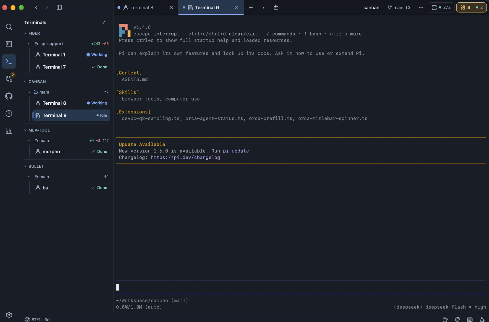

<h1 align="center">
  <a href="https://canban.dev/zh/"></a> Canban
</h1>

<p align="center">
  <a href="https://github.com/jjyr/canban/releases"></a>
  <a href="LICENSE"></a>
  
  
</p>

<p align="center">
  <sub><a href="README.md">English</a> · <strong>简体中文</strong></sub>
</p>

<p align="center">
  <strong>用看板理清任务，用原生 Agent CLI 完成开发。</strong><br/>
  基于原生 <strong>Rust + <code>libghostty</code></strong> 构建的轻量级应用（零 Electron、不做聊天框套壳），让 <strong>Claude Code、Codex、Cursor CLI、Antigravity（<code>agy</code>）</strong> 等真实终端 CLI 与每日简报收件箱（Daily Briefing Inbox）、本地看板、持久化 PTY 及单卡 Git Worktree 审查自然协同。
</p>

<h3 align="center"><a href="#安装"><ins>快速安装</ins></a> · <a href="https://canban.dev/zh/"><ins>canban.dev</ins></a> · <a href="https://canban.dev/zh/docs/"><ins>文档</ins></a></h3>

<p align="center">
  
</p>

## 为什么选择 Canban？

- **从每日简报（Daily Briefing）开始**：跨项目、GitHub PR、定时任务与远程主机的降噪收件箱——行内直接回复阻塞中的 Agent、一键合并 CI 全绿的 PR，把被动订阅噪音自动折叠在视线之外。
- **用看板理清任务**：围绕任意本地目录或 Git 仓库建立看板（`Backlog → Develop → Review`），把需求描述、评论、独立 Worktree 与行内 Diff 集中在同一张卡片，零上手门槛。
- **用原生 Agent CLI 工作**：在持久化防中断 PTY 中直接运行真实的 `claude`、`codex`、`agy`、`cursor-agent` 或 `pi` CLI，完整保留原生 TUI、权限交互、MCP、Skills 与会话恢复。
- **轻量原生、支持多机**：基于 Rust + NSH + `libghostty-vt` 与本地 SQLite 构建，无 Electron、无 Chromium、不绑定云账号，并可端到端加密直连远程 Linux `canband` 主机与 Android 客户端。

## 核心功能

<table>
<tr>
<td width="50%" valign="middle">

### 每日简报收件箱（Daily Briefing Inbox）

跨所有项目、Worktree、GitHub PR、定时运行与远程主机的每日统一入口。通过顶部可点击决策过滤条（`Waiting On You`、`Ready to Merge`、`Agents`、`Shipped Today`）快速聚焦，支持行内直接回复等待中的 Agent 或 PR、应用内展开阅读 PR Markdown 与 CI 检查状态，一键直达对应卡片与实时终端，并自动将低优先级订阅动态降噪折叠。

</td>
<td width="50%">
  
</td>
</tr>
<tr>
<td width="50%" valign="middle">

### 看板与卡片上下文

围绕任意本地目录或 Git 仓库构建简洁的 `Backlog → Develop → Review` 看板。将 Markdown 任务说明、截图、`#Card` 与 GitHub Issue/PR 关联以及 `@Agent` 讨论集中在一处，紧邻右侧实时终端。

</td>
<td width="50%">
  
</td>
</tr>
<tr>
<td width="50%" valign="middle">

### 原生 Agent CLI 与持久化终端

拒绝聊天框套壳。在基于 Rust、NSH 与 `libghostty-vt` 构建的持久化防中断 PTY 中，直接运行 Claude Code、Codex、Antigravity（`agy`）、Cursor CLI、Pi 或自定义 CLI，完整保留原生 TUI、权限交互、MCP、Skills 与会话恢复能力。

[文档 →](https://canban.dev/zh/docs/agents/)

</td>
<td width="50%">
  
</td>
</tr>
<tr>
<td width="50%" valign="middle">

### 独立 Worktree 与行内 Diff 审查

无需切出应用去开外部编辑器，直接查看提交历史与单卡片隔离 Worktree 的代码改动。支持在变更代码行上直接添加行内评审意见，并一键发送给 `@Agent` 继续修改。

[文档 →](https://canban.dev/zh/docs/)

</td>
<td width="50%">
  
</td>
</tr>
<tr>
<td width="50%" valign="middle">

### 定时运行与可编程工作流（按需启用）

按 Cron 计划定期执行 Agent 任务，并在收件箱中直接查看运行结果或一键重试失败任务。需要进一步自动化时，可按需启用类似 GitHub Actions 的本地 YAML 工作流，串联 Shell 脚本、`agent` + prompt 步骤与串行合并队列。

[文档 →](https://canban.dev/zh/docs/workflows/)

</td>
<td width="50%">
  
</td>
</tr>
<tr>
<td width="50%" valign="middle">

### 多机器协同（全程 E2E 直连）

把高负载编译和 Agent 任务交给远程 Linux 主机。通过桌面端或移动端直接连接无头 `canband` 主机，全程强制端到端加密、无任何中转服务器——可选配合 **Tailscale** 或 **SSH** 使用——像操作本地项目一样丝滑管理远程看板、收件箱分流、工作流与 120Hz 实时终端。

[文档 →](https://canban.dev/zh/docs/remote-hosts/)

</td>
<td width="50%">
  
</td>
</tr>
</table>

## 隐私与安全

- **零资料收集**：无云账号、无遥测、无埋点统计，不收集任何使用数据。你的看板、卡片、工作流与密钥全部留在你自己的设备本地 SQLite 中（密钥库静态加密存储）。
- **无中转、全程端到端加密（E2E）**：桌面端、移动端与远程 `canband` 主机之间完全点对点直连，所有流量默认强制端到端加密并进行公钥校验，不经过任何第三方中转或官方服务器。
- **可选配合 Tailscale 或 SSH**：开箱即支持局域网 / 私有网络直连，也支持按需配合 **Tailscale**（免公网暴露、同账号免扫码自动认证）或 **SSH** 使用。

如需查看具体加密协议、主机公钥固定与密钥库实现细节，请参阅 [隐私与安全文档 →](https://canban.dev/zh/docs/#privacy-security)。

## 安装

在 **macOS 13+**（Apple Silicon）或 **Linux 桌面版**（`x86_64` / `arm64`）上一键安装：

```bash
curl -fsSL https://canban.dev/install.sh | bash
```

开箱即用，直接复用你现有的 `git` 与各类 Agent CLI（`claude`、`codex`、`agy`、`cursor-agent` 等）。首次启动时，若未安装持久化终端守护进程（`hc`），Canban 会自动引导一键完成配置。

### Android 客户端（`arm64-v8a`）

<p>
  <a href="https://github.com/jjyr/canban/releases/latest"></a>
  <a href="https://apps.obtainium.imranr.dev/redirect?r=obtainium://app/%7B%22id%22%3A%22dev.canban.mobile%22%2C%22url%22%3A%22https%3A%2F%2Fgithub.com%2Fjjyr%2Fcanban%22%2C%22author%22%3A%22jjyr%22%2C%22name%22%3A%22Canban%22%7D"></a>
</p>

全程端到端加密、无中转直连你的 macOS 或远程 Linux `canband` 主机，支持一次性 `canban://` 二维码配对，或可选配合 **Tailscale**（WhoIs 同账号免扫码直连），随时在手机端处理 Needs you 审批、看板、Git Diff 与原生 `libghostty-vt` 实时终端。

<details>
<summary><strong>Linux 运行库要求与从源码构建</strong></summary>

<br/>

**Linux 桌面版运行库依赖**：
- 已安装 GTK4 与 GStreamer 运行库（`libgtk-4-1` / `gtk4` + `gstreamer`）

**从源码构建**（需安装 `mise` 与系统构建依赖后执行 `mise run install-app`）：

- **macOS**：`brew install librsvg`
- **Ubuntu / Debian**：`sudo apt install pkg-config libgtk-4-dev libgstreamer1.0-dev libgstreamer-plugins-base1.0-dev librsvg2-bin zstd`
- **Arch Linux**：`sudo pacman -S pkgconf gtk4 gstreamer gst-plugins-base librsvg zstd`
- **Fedora**：`sudo dnf install pkgconf-pkg-config gtk4-devel gstreamer1-devel gstreamer1-plugins-base-devel librsvg2-tools zstd`

```bash
git clone https://github.com/jjyr/canban.git && cd canban && mise run install-app
```

</details>

## 相关软件与致谢

Canban 基于以下开源项目构建（完整归属与许可证见 [THIRD_PARTY_NOTICES.md](THIRD_PARTY_NOTICES.md)）：

- **[Herdr](https://github.com/herdrdev/herdr-core)** - 面向原生 Agent CLI 的持久化 PTY 会话监督引擎
- **[Sheprd](https://github.com/sheprd-labs/sheprd)** - 终端 VT 与订阅交互实践参考
- **[NSH](https://github.com/longbridge/nsh)** - 原生 macOS 与 Linux Rust UI 框架
- **[Ghostty](https://github.com/ghostty-org/ghostty)** - `libghostty-vt` 终端解析与渲染内核
- **[iTerm2-Color-Schemes](https://github.com/mbadolato/iTerm2-Color-Schemes)** - 内置终端配色方案
- **[Lucide](https://lucide.dev)**、**[Lobe Icons](https://github.com/lobehub/lobe-icons)**、**[Primer Octicons](https://github.com/primer/octicons)** - UI 与模型/服务商图标

## 开源协议

Copyright 2026 JJy \<jjyruby@gmail.com\>.

本项目基于 [Apache License, Version 2.0](LICENSE) 开源。
